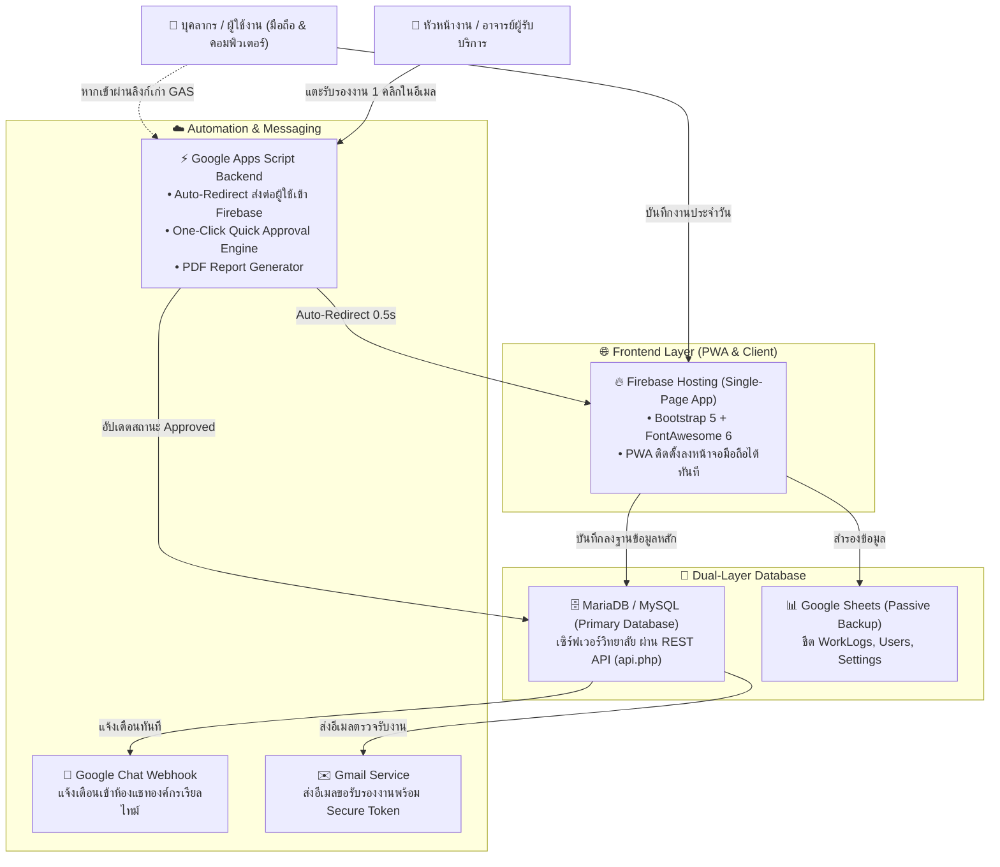

<div align="center">
<p align="center">
  
  &nbsp;&nbsp;&nbsp;&nbsp;
  
  
  &nbsp;&nbsp;&nbsp;&nbsp;
</p>

# 📋 ระบบรายงานการปฏิบัติงานของบุคลากร (BCNSPRNW WorkReport)
### Personnel Duty Performance Reporting & Evaluation Platform
**วิทยาลัยพยาบาลบรมราชชนนี สวรรค์ประชารักษ์ นครสวรรค์ | คณะพยาบาลศาสตร์ สถาบันพระบรมราชชนก**

[](https://cit-workreport.web.app)
[](https://firebase.google.com/)
[](https://developers.google.com/apps-script)
[](https://mariadb.org/)
[](LICENSE)

</div>

<br>

### ⚡ ทางลัดเข้าสู่ระบบและเอกสารข้อมูล (Quick Access Hub)

<table align="center" width="100%">
  <tr>
    <td align="center" width="33%" valign="top">
      <br>
      <a href="https://cit-workreport.web.app">
        
      </a>
      <br><br>
      <b>🌐 เข้าใช้งานระบบจริง</b>
      <p><sub>เว็บบันทึกงาน PWA สำหรับบุคลากร ติดตั้งลงมือถือได้ ใช้งานสะดวกรวดเร็ว</sub></p>
      <a href="https://cit-workreport.web.app">
        
      </a>
      <br><br>
      <sub>🔗 <a href="https://cit-workreport.web.app"><b>เปิดใช้งานระบบทันที →</b></a></sub>
      <br><br>
    </td>
    <td align="center" width="33%" valign="top">
      <br>
      <a href="USER_MANUAL.md">
        
      </a>
      <br><br>
      <b>📖 คู่มือการใช้งาน (TOR)</b>
      <p><sub>ขั้นตอนการบันทึกงาน การตรวจรับรองงาน One-Click และคำแนะนำระบบ</sub></p>
      <a href="USER_MANUAL.md">
        
      </a>
      <br><br>
      <sub>📑 <a href="USER_MANUAL.md"><b>อ่านคู่มือฉบับเต็ม →</b></a></sub>
      <br><br>
    </td>
    <td align="center" width="33%" valign="top">
      <br>
      <a href="mailto:hr@bcnsprnw.ac.th?subject=%E0%B9%81%E0%B8%88%E0%B9%89%E0%B8%87%E0%B8%9B%E0%B8%B1%E0%B8%8D%E0%B8%87%E0%B8%B2%E0%B8%A3%E0%B8%B0%E0%B8%9A%E0%B8%9A%E0%B8%A3%E0%B8%B2%E0%B8%A2%E0%B8%87%E0%B8%B2%E0%B8%99%E0%B8%81%E0%B8%B2%E0%B8%A3%E0%B8%9B%E0%B8%8F%E0%B8%B4%E0%B8%9A%E0%B8%B1%E0%B8%95%E0%B8%B4%E0%B8%87%E0%B8%B2%E0%B8%99%20BCNSPRNW">
        
      </a>
      <br><br>
      <b>💬 รายงานปัญหา / เสนอแนะ</b>
      <p><sub>แจ้งปัญหาการใช้งาน ข้อขัดข้อง หรือติดต่อฝ่ายบุคคลและทีมเทคนิค (CIT)</sub></p>
      <a href="mailto:hr@bcnsprnw.ac.th?subject=%E0%B9%81%E0%B8%88%E0%B9%89%E0%B8%87%E0%B8%9B%E0%B8%B1%E0%B8%8D%E0%B8%87%E0%B8%B2%E0%B8%A3%E0%B8%B0%E0%B8%9A%E0%B8%9A%E0%B8%A3%E0%B8%B2%E0%B8%A2%E0%B8%87%E0%B8%B2%E0%B8%99%E0%B8%81%E0%B8%B2%E0%B8%A3%E0%B8%9B%E0%B8%8F%E0%B8%B4%E0%B8%9A%E0%B8%B1%E0%B8%95%E0%B8%B4%E0%B8%87%E0%B8%B2%E0%B8%99%20BCNSPRNW">
        
      </a>
      <br><br>
      <sub>✉️ <a href="mailto:hr@bcnsprnw.ac.th?subject=%E0%B9%81%E0%B8%88%E0%B9%89%E0%B8%87%E0%B8%9B%E0%B8%B1%E0%B8%8D%E0%B8%87%E0%B8%B2%E0%B8%A3%E0%B8%B0%E0%B8%9A%E0%B8%9A%E0%B8%A3%E0%B8%B2%E0%B8%A2%E0%B8%87%E0%B8%B2%E0%B8%99%E0%B8%81%E0%B8%B2%E0%B8%A3%E0%B8%9B%E0%B8%8F%E0%B8%B4%E0%B8%9A%E0%B8%B1%E0%B8%95%E0%B8%B4%E0%B8%87%E0%B8%B2%E0%B8%99%20BCNSPRNW"><b>ส่งอีเมลแจ้งเรื่อง →</b></a></sub>
      <br><br>
    </td>
  </tr>
</table>

---

## 📖 เกี่ยวกับระบบ (About The Project)

**ระบบรายงานการปฏิบัติงานของบุคลากร (BCNSPRNW WorkReport Platform)** พัฒนาขึ้นเพื่อเป็นแพลตฟอร์มกลางในการบันทึก ติดตาม และประเมินผลการปฏิบัติราชการประจำวันของบุคลากรสายสนับสนุน ช่วยลดขั้นตอนเอกสารแบบเดิมสู่ระบบดิจิทัลไร้กระดาษ (Paperless 100%) พร้อมเชื่อมต่อระบบการตรวจรับรองงานด่วนผ่านอีเมล การแจ้งเตือนเข้าห้องแชทองค์กร และการประมวลผลสถิติแบบเรียลไทม์

ระบบถูกออกแบบภายใต้สถาปัตยกรรม **Modern Hybrid Web App** ที่ผสมผสานความเร็วของ **Progressive Web App (PWA)** บน Firebase Hosting เข้ากับความมั่นคงปลอดภัยของ **MariaDB Database** และความยืดหยุ่นของ **Google Workspace Automation**

---

## ✨ จุดเด่นและความสามารถหลัก (Key Features)

### 👤 1. สำหรับผู้ปฏิบัติงาน (Staff Experience)
* ⚡ **Smart Multi-Task Logging:** บันทึกงานประจำวันได้หลายงานในวันเดียว พร้อมเลือกผู้รับบริการเฉพาะแต่ละงานได้อย่างอิสระ
* ⚡ **Quick Result Chips:** ปุ่มลัดเลือกผลลัพธ์สำเร็จรูปยอดนิยม (เช่น *ดำเนินการเสร็จเรียบร้อยแล้ว*, *ส่งมอบงานแล้ว*) แตะเพียง 1 คลิกใส่ข้อความทันทีโดยไม่ต้องพิมพ์
* 🎤 **Voice Typing Integration:** แนะนำการใช้ไมโครโฟนบนแป้นพิมพ์เพื่อพูดไทยแทนการพิมพ์
* ⛶ **Focus Writing Mode:** โหมดขยายจอพิมพ์สบายตา มองเห็นข้อความชัดเจน ไม่โดนแป้นพิมพ์มือถือบดบัง
* 💾 **Auto-Save Draft:** กู้คืนข้อความร่างอัตโนมัติจาก LocalStorage ไม่ต้องกังวลว่าข้อความจะหายหากปิดเบราว์เซอร์หรือแบตเตอรี่หมด
* 📅 **Interactive Calendar & History:** ตรวจสอบประวัติงานย้อนหลังทั้งในรูปแบบตารางและปฏิทินงาน แยกสถานะด้วยแถบสีชัดเจน

### 👔 2. สำหรับหัวหน้างานและผู้รับบริการ (Supervisor & Approver)
* ✉️ **One-Click Email Approval:** ตรวจรับรองงานได้ทันทีจากในอีเมลแจ้งเตือนบนมือถือ **โดยไม่ต้องล็อกอินเข้าสู่ระบบ**
* 🔒 **Expiring Security Token:** ลิงก์ตรวจรับรองงานผูกด้วยรหัสความปลอดภัย HMAC-SHA256 มีอายุใช้งาน 7 วัน ป้องกันการปลอมแปลง
* 📝 **In-App Review & Reject:** ตรวจสอบงานผ่านหน้าเว็บ พร้อมฟังก์ชันส่งกลับแก้ไขและระบุเหตุผลประกอบ ซึ่งระบบจะส่งอีเมลแจ้งเจ้าหน้าที่ทันที

### 📊 3. สำหรับงานบุคคลและผู้บริหาร (HR & Executive)
* 📈 **Executive Analytics Dashboard:** แดชบอร์ดสรุปสถิติ KPI, ปริมาณงานรายฝ่าย, อัตราการรับรองงาน (%) แบบเรียลไทม์
* 📑 **Official Report Generation:** ออกรายงานสรุปภาระงานรายเดือน/รายสัปดาห์ แปลงเป็นเอกสาร PDF ทางการตามฟอร์มของวิทยาลัย
* 👥 **Staff & Hierarchy Management:** จัดการข้อมูลบุคลากร และผูกสายการบังคับบัญชา (Supervisor Mapping) อัตโนมัติ

---

## 🏗️ สถาปัตยกรรมระบบ (System Architecture)



---

## 📁 โครงสร้างโปรเจกต์ (Repository Structure)

```text
├── public/                     # ไฟล์เว็บที่คอมไพล์แล้วสำหรับ Deploy บน Firebase Hosting
│   └── index.html              # Standalone Production Build (Single-File SPA)
├── scripts/
│   └── build_firebase.js       # สคริปต์คอมไพล์ รวมไฟล์ HTML/JS/CSS ทั้งหมดเป็นไฟล์เดียว
├── 00_Config.js                # ศูนย์รวมการตั้งค่าระบบ (Configuration & Keys)
├── 01_Security.js              # ระบบความปลอดภัย, ตรวจสอบสิทธิ์, สร้างและตรวจสอบ HMAC Token
├── 02_Database.js              # โมดูลเชื่อมต่อและจัดการชีต Google Sheets
├── 03_NotificationService.js   # ระบบแจ้งเตือน Google Chat Webhook และ Email HTML
├── 04_TaskService.js           # ตรรกะการบันทึก, ตรวจสอบ (Validation) และอนุมัติงาน
├── 05_UserService.js           # จัดการข้อมูลผู้ใช้และสายการบังคับบัญชา
├── 06_ReportService.js         # ประมวลผลเอกสารรายงาน Google Docs & PDF Export
├── 07_DashboardService.js      # คำนวณสถิติและตัวชี้วัด KPI
├── 08_AdminService.js          # ฟังก์ชันงานบุคคลและผู้ดูแลระบบ
├── 09_AppController.js         # Entry Point หลักของ GAS (Router, Auto-Redirect, Approval)
├── 10_ApiAuth.js               # ระบบตรวจสอบความถูกต้องของ API Token
├── 98_MariaDbClient.js         # ไคลเอนต์เชื่อมต่อ MariaDB REST API และฟังก์ชัน Sync
├── 99_SheetMigration.js        # สคริปต์ติดตั้งและอัปเกรดโครงสร้างฐานข้อมูลชีต
├── api.php                     # REST API Backend สำหรับ MariaDB บน Ubuntu Server
├── Index.html                  # หน้าจอโครงร่างหลัก (Main App Layout)
├── Header.html                 # ส่วนหัวแสดงโปรไฟล์และสถานะระบบ
├── NavTabs.html                # แถบเมนูนำทางด้านล่าง (Bottom Navigation Bar)
├── Tab_WorkForm.html           # ฟอร์มบันทึกภาระงานประจำวัน
├── Tab_Pending.html            # หน้าตรวจรับรองงานสำหรับหัวหน้างาน
├── Tab_HistoryCalendar.html    # หน้าประวัติและปฏิทินงาน
├── Tab_Report.html             # หน้าสรุปผลและออกรายงานทางการ
├── Tab_Hr.html                 # หน้าจัดการรายชื่อบุคลากร (HR)
├── Tab_Admin.html              # หน้าตั้งค่าระบบขั้นสูง
├── Tab_Dashboard.html          # หน้าแสดงแดชบอร์ดสถิติผู้บริหาร
├── Modals.html                 # หน้าต่างป๊อปอัป (Focus Modal, Voice Help, User Manage)
├── Style.html                  # สไตล์ CSS รวมศูนย์ ออกแบบตามอัตลักษณ์องค์กร
├── Script_Core.html            # สคริปต์แกนกลาง, ระบบแจ้งเตือน Toast, Confirm Dialog
├── Script_WorkForm.html        # สคริปต์ควบคุมการบันทึกงาน, Quick Chips, Auto-Save Draft
├── Script_Approval.html        # สคริปต์ระบบตรวจรับรองงานและการส่งกลับแก้ไข
├── Script_Calendar.html        # สคริปต์ปฏิทินงานและการแสดงผลประวัติ
├── Script_Report.html          # สคริปต์ตัวอย่างและดาวน์โหลดรายงาน
├── Script_Dashboard.html       # สคริปต์เรนเดอร์กราฟ Chart.js
├── firebase.json               # การตั้งค่า Firebase Hosting (PWA, Caching, Rewrite)
└── appsscript.json             # Manifest การตั้งค่า Google Apps Script
```

---

## 💻 เทคโนโลยีที่ใช้พัฒนา (Tech Stack)

* **Frontend:**
  * HTML5, CSS3, JavaScript (Vanilla ES6+)
  * [Bootstrap 5.3](https://getbootstrap.com/) - Responsive Grid & UI Components
  * [FontAwesome 6](https://fontawesome.com/) - Iconography
  * [TomSelect 2.2](https://tom-select.js.org/) - Advanced Autocomplete Dropdowns
  * [Flatpickr](https://flatpickr.js.org/) - Thai Buddhist Era (พ.ศ.) Date Picker
  * [Chart.js 4.4](https://www.chartjs.org/) - Data Visualizations & Analytics
* **Hosting & Cloud Platform:**
  * [Firebase Hosting](https://firebase.google.com/docs/hosting) - Fast Global CDN with PWA Cache
  * [Google Apps Script (GAS)](https://developers.google.com/apps-script) - Backend Services & Integration
* **Database & API:**
  * **Primary:** MariaDB / MySQL บน Linux Ubuntu Server เชื่อมต่อด้วย PHP 8 REST API
  * **Secondary / Backup:** Google Sheets API
* **Security & Auth:**
  * Google Workspace Single Sign-On (SSO) via Firebase Auth
  * HMAC-SHA256 Expiring URL Signatures สำหรับ Quick Approval
  * Multi-Tier Session Persistence (LocalStorage, SessionStorage, Secure Cookie)

---

## 🚀 การติดตั้งและนำไปใช้งาน (Deployment Guide)

### 1. ข้อกำหนดเบื้องต้น (Prerequisites)
* Node.js (เวอร์ชัน 18 ขึ้นไป)
* Firebase CLI (`npm install -g firebase-tools`)
* Google Clasp CLI (`npm install -g @google/clasp`)

### 2. การคอมไพล์โค้ด (Build Process)
รันสคริปต์เพื่อรวมไฟล์ส่วนประกอบทั้งหมดเป็นไฟล์ Standalone สำหรับ Firebase:
```powershell
node scripts/build_firebase.js
```
*(ไฟล์ผลลัพธ์จะถูกสร้างไว้ที่ `public/index.html` พร้อมสำหรับการ Deploy)*

### 3. การ Deploy ขึ้น Firebase Hosting
```powershell
firebase deploy --only hosting
```

### 4. การ Push โค้ดขึ้น Google Apps Script
```powershell
clasp push
```

---

## 🛡️ ความปลอดภัยและความเป็นส่วนตัว (Security)

1. **ปลอดภัยจาก XSS:** มีการกรองและ Escape อักขระพิเศษ (`escapeHtml`) ในทุกอินพุตก่อนนำไปแสดงผล
2. **ระบบสิทธิ์ตามบทบาท (RBAC):** แยกสิทธิ์ชัดเจนระหว่าง ผู้ปฏิบัติงาน (Staff), คณาจารย์ (Faculty), หัวหน้างาน (Supervisor) และผู้ดูแลระบบ (Admin)
3. **Audit Trail Logging:** บันทึกประวัติการเข้าใช้งานและเวลาการอนุมัติงานทุกรายการอย่างโปร่งใส

---

## 👥 ผู้พัฒนาและลิขสิทธิ์ (Credits & License)

* **พัฒนาโดย:** กลุ่มงานเทคโนโลยีสารสนเทศ (CIT) และ งานทรัพยากรบุคคล (HR)  
  วิทยาลัยพยาบาลบรมราชชนนี สวรรค์ประชารักษ์ นครสวรรค์ คณะพยาบาลศาสตร์ สถาบันพระบรมราชชนก
* **ช่องทางติดต่อ:** `hr@bcnsprnw.ac.th`
* **ลิขสิทธิ์:** ซอฟต์แวร์นี้เผยแพร่ภายใต้ลิขสิทธิ์ [MIT License](LICENSE) สามารถนำไปศึกษาและต่อยอดเพื่อประโยชน์ทางการศึกษาและสาธารณประโยชน์
